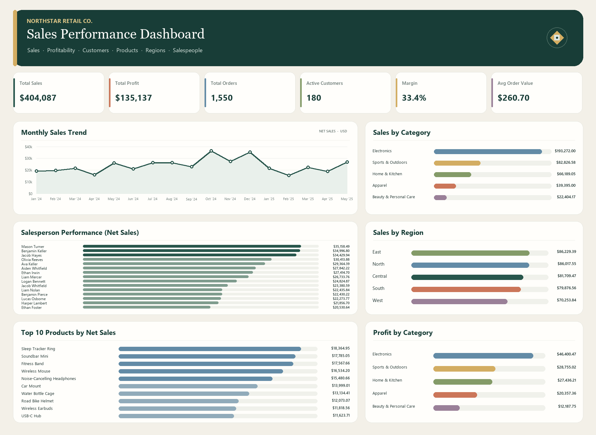

# Retail Sales Analysis Dashboard

An Excel portfolio project that explores retail sales, profitability, customers, products, regions, and salesperson performance. The workbook combines transaction-level data, lookup/reference data, pivot-style summaries, supporting calculations, business recommendations, and an executive dashboard.

## Dashboard highlights

- **Net sales:** $404,086.80
- **Profit:** $135,136.81
- **Orders:** 1,550
- **Active customers:** 180
- **Profit margin:** 33.4%
- **Average order value:** $260.70

Figures above are taken from the workbook's existing summary/dashboard and reflect the workbook as provided. Currency formatting follows the workbook.

## Workbook contents

| Sheet | Purpose |
| --- | --- |
| `Dash` | Excel dashboard charts for headline sales and performance views |
| `Dashboard` | Dashboard preview image embedded in the workbook |
| `Data` | Transaction records and customer, product, and salesperson reference tables |
| `pivotTables` | Pivot-style summary outputs used by the dashboard |
| `Analysis` | Supporting calculations and grouped sales/profit summaries |
| `Insights` | Business interpretation and key findings |
| `recommendations` | Suggested actions linked to findings |
| `Task` | Original assignment brief included in the workbook |

## Analysis included

- Monthly sales trend
- Sales and profit by product category
- Regional sales
- Profitability and margin
- Salesperson performance
- Top products by net sales
- Customer and order summary metrics

## Files

- [`Retail-Sales-Analysis.xlsx`](Retail-Sales-Analysis.xlsx) — the Excel workbook and dashboard
- [`assets/dashboard-preview.png`](assets/dashboard-preview.png) — image preview for this README
- [`GITHUB_UPLOAD_GUIDE_AR.md`](GITHUB_UPLOAD_GUIDE_AR.md) — Arabic instructions for creating and uploading this repository

## Open the project

Download the workbook and open it in Microsoft Excel. For the interactive workbook dashboard, open the `Dash` sheet. The README preview is a static image.

## Data and privacy

The workbook includes transaction-level data. Review the file and confirm you are allowed to share its data before making the GitHub repository public. If the data is not intended for public sharing, create a **private** repository or remove/replace the workbook's source data before publishing.

## Tools

- Microsoft Excel
- Excel tables, formulas, pivot-style summaries, and charts

## License

No license is provided. All rights remain with their respective owner unless a license is added.